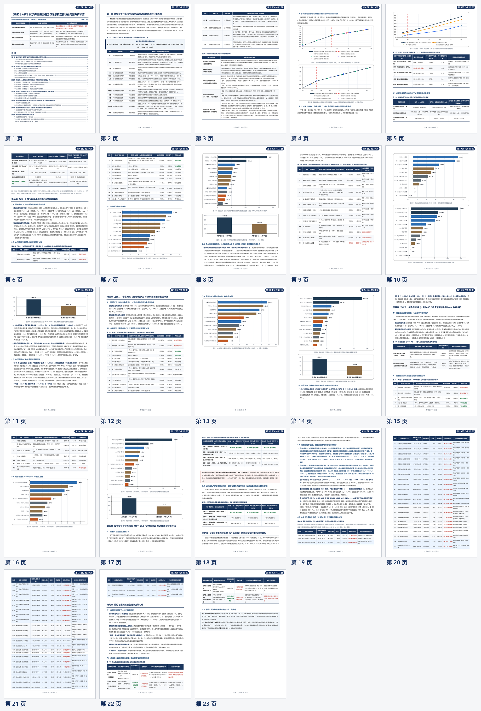

在《燕云十六声》（Where Winds Meet）中，装备词条调律、定音选择（外穿 vs 属穿）、以及会心与会意流派的收益权衡，一直是广大少侠配装的核心痛点。

本研究基于**多武器全量控制变量实测木桩数据**（覆盖斩雪刀法、唐刀、通用长枪、决狱悬峰枪、陌刀、扇武学、手甲及无名剑法八大武学体系，共 50 组独立工况/51 行验算数据）反推校准，完整揭示了游戏的伤害底层计算公式、四色互斥判定链与双穿透双段 $2:1$ 折线拐点机制。

同时，我们正式开源了全套研究报告与全自动 Excel 交互计算器！

- **GitHub 开源仓库**：**<https://github.com/Iridescent10-art/Where-Winds-Meet-Damage-Calculator>**
- **配套 Excel 计算器下载**：[直接下载 `燕云十六声全自动武学伤害与词条收益计算器.xlsx`](https://github.com/Iridescent10-art/Where-Winds-Meet-Damage-Calculator/raw/main/%E7%87%95%E4%BA%91%E5%8D%81%E5%85%AD%E5%A3%B0%E5%85%A8%E8%87%AA%E5%8A%A8%E6%5B%A6%E5%AD%A6%E4%BC%A4%E5%AE%B3%E4%B8%8E%E8%AF%8D%E6%9D%A1%E6%94%B6%E7%9B%8A%E8%AE%A1%E7%AE%97%E5%99%A8.xlsx)
- **完整 PDF 报告（23页高清）**：[查看 PDF](https://github.com/Iridescent10-art/Where-Winds-Meet-Damage-Calculator/blob/main/docs/%E7%87%95%E4%BA%91%E5%8D%81%E5%85%AD%E5%A3%B0%E6%AD%A6%E5%AD%A6%E4%BC%A4%E5%AE%B3%E5%BA%95%E5%B1%82%E6%A8%A1%E5%9E%8B%E4%B8%8E%E8%AF%8D%E6%9D%A1%E5%92%8C%E5%AE%9A%E9%9F%B3%E6%94%B6%E7%9B%8A%E5%AE%8C%E6%95%B4%E5%88%86%E6%9E%90%E6%8A%A5%E5%91%8A.pdf)

---

## 🎯 核心结论速览

1. **四条外穿定音（56.0 外穿）为全流派不可动摇铁律**：  
   首领外抗以 $25.0$ 为拐点（$<25$ 分母 100 负穿惩罚，$\ge 25$ 分母 200 正穿增益）。卸下 4 条外穿定音会导致面板外穿跌至 $4.8$（严重跌破 25 拐点），三大流派总期望瞬间暴跌 **$12.8\% \sim 14.9\%$**！替换任何一条外穿定音为属穿定音均稳定净亏 $1.64\% \sim 2.08\%$。
2. **大外攻（139.6）全面压制大本属（79.2）**：  
   在 $15\%$ 满武库属伤与 $30.0/36.0$ 属穿下，大外攻反超大本属的临界外穿仅需 $22.84 \sim 27.20$。当前毕业外穿 $56.0$ 远超临界线，大外攻收益稳定领先大本属 $14\% \sim 18\%$。
3. **纯会意 7000 大外（期望 4463.60）反超常规会心流（4456.06）**：  
   当装备完全舍弃精准和会心词条、将省下的词条拉满大外攻至 $7000$ 时，凭借实战 $140.2\%$ 会意伤害与 $44.6\%$ 会意率，总期望正式反超毕业级常规会心流！
4. **会心流“小外 > 大外倒挂”（4500-4300）创全流派期望峰值（4506.33）**：  
   当面板生效小外大于大外时，触发底层“最小大于最大直接取最小”机制，四色跳字全部锁定 4500 结算，满值小外攻收益飙升 **$2.16$ 倍（+99.96 点）**，登顶常规第一。
5. **串联互斥判定链**：  
   严格按 **橙字会意 → 灰字擦伤（未精准） → 黄字会心 → 白字普伤** 顺序判定。常规面板上限为会心 80% / 会意 40%，心法/奇术提供的直接双暴可无视上限额外叠加。

---

## 🧮 单次确定状态武学伤害总公式

$$D = \left\{ \left[ (A_{\text{外}} \times C_{\text{外}} + F_{\text{外}}) \times f_{\text{外防}} \times (1 + g_{\text{外}}) \times M_{\text{外}} + (A_{\text{本属}} \times C_{\text{属}} + F_{\text{属}}) \times (1 + g_{\text{属}}) \times M_{\text{本属}} \right] \times M_{\text{特}} + A_{\text{外属}} \times C_{\text{外}} \times 0.680 \right\} \times M_{\text{双暴}} \times (1 + G_{\text{增}})$$

### 乘区关键参数拆解：
- **动态外防承伤率**：$f_{\text{外防}} = A_{\text{外}} / (A_{\text{外}} + 250)$，目标首领外防常数 $D_{\text{外}} = 250$ 点。
- **外攻穿透乘区 $M_{\text{外}}$**：拐点 $25.0$。低于 25 时 $M_{\text{外}} = 1 + (P_{\text{外}} - 25)/100$；高于 25 时 $M_{\text{外}} = 1 + (P_{\text{外}} - 25)/200$。
- **本系属攻穿透乘区 $M_{\text{本属}}$**：拐点 $30.0$。低于 30 时 $M_{\text{本属}} = 1 + (P_{\text{属}} - 30)/90$；高于 30 时 $M_{\text{本属}} = 1 + (P_{\text{属}} - 30)/180$。
- **外系属攻**：不吃本系属伤与属穿，按外攻倍率 $C_{\text{外}}$ 与专属固定裸抗系数 $0.680$ 独立结算。
- **全局增伤 $G_{\text{增}}$**：涵盖全武学、指定武学、首领增伤及四件套同武器 $+10\%$ 气血增伤等。

---

## 📊 四大配装工况调律决策一览

| 配装路线 / 工况 | 核心面板与三率特征 | 单次总期望 $E_0$ | 定音铁律 | 三率补齐后常规词条优先级 | 溢出 / 避坑警示 |
| :--- | :--- | :---: | :---: | :--- | :--- |
| **会心流派 （常规面板）** | 外攻 3934–4859 精准97.5% / 会心80%+9.16% 实战会心伤 154.0% | **4456.06 点** | 4 条外穿定音 | 80%会心前：**敏(+61.08) > 大外攻(+53.59) > 劲(+52.64) > 大本属(+46.90)** | 面板会心满80%后敏跌至+26.37，转堆大外与劲；避坑大外属 |
| **会心流派 （小外>大外倒挂）** | 外攻 4500–4300 触发最小>最大固定伤害 黄字反超橙字 +5.18% | **4506.33 点 （全流派最高）** | 4 条外穿定音 | **小外攻(+99.96) > 未超标敏(+92.28) > 超标敏(+56.84) > 大本属(+46.90)** | 大外攻(+0.00)与劲(+14.21)大幅失效，未超标势(-0.12)负收益 |
| **均衡会意 （要精准会心）** | 外攻 1950–6493 精准92.4% / 会意40%+4.6%=44.6% 实战会意伤 140.2% | **4420.97 点** | 4 条外穿定音 | 40%会意前：**势(+67.79) > 大外攻(+62.61) > 劲(+57.30) > 大本属(+53.03)** | 面板会意满40%后势跌至+35.60，立刻转堆大外攻与劲 |
| **纯会意流派 （7000大外极限）** | 外攻 1950–7000 放弃精准会心堆满大外 会意 40%+4.6% = 44.6% | **4463.60 点 （常规形态榜首）** | 4 条外穿定音 | 40%会意前无脑堆**势(+74.18)**；满40%后：**大外攻(+60.11) > 劲(+55.02) > 大本属(+50.92)** | 会意触顶40%后停堆势(+34.18)；绝对避坑敏(+13.48) |

---

## 🖥️ 交互计算器体验指南

计算器包含四大独立计算分表与实时联动的【四流派动态横向总览】：
1. **自动联动重算**：在任意分表修改左侧**浅黄色单元格**（基础攻击、判定属性、技能倍率），全表公式将自动重算四色跳字期望、全词条收益排行、穿透定音增量及平衡临界线。
2. **多维柱状图直观呈现**：内嵌 24 张动态图表，直观对比各词条单次跳字与期望收益贡献。
3. **欢迎前往 GitHub 下载体验**：[Iridescent10-art/Where-Winds-Meet-Damage-Calculator](https://github.com/Iridescent10-art/Where-Winds-Meet-Damage-Calculator)
